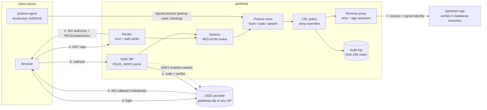

# gatekeep

[](https://github.com/SlateGitOrg/gatekeep/actions/workflows/ci.yml)

An identity-aware reverse proxy in Go, in the BeyondCorp style. Every request is authorized on who is calling, from what device, and what they are asking for. Being on the "inside" of a network grants nothing.

gatekeep sits in front of internal web apps. For each request it:

1. authenticates the user with **OpenID Connect** (authorization code + **PKCE S256**). It validates the ID token strictly: signature against a **rotating JWKS**, plus `iss`, `aud`, `azp`, `exp`, `iat`, `nonce` and token age.
2. keeps the session in an **AES-256-GCM encrypted, purpose-bound cookie** (`__Host-` prefix, `Secure`, `HttpOnly`, `SameSite=Lax`). The cookie has idle and absolute timeouts, key rotation, and server-side revocation on logout.
3. checks **device posture**. An in-repo agent signs the posture as a short-lived EdDSA/ES256 assertion. The assertion is bound to the browser session through a single-use pairing code, is replay-protected by `jti`, and goes **stale** after a configurable age.
4. evaluates the route's **CEL policy** over typed `identity`, `device` and `request` attributes. The policy uses deny-overrides, fails closed, has a cost limit, and is type-checked at startup.
5. writes a **hash-chained JSON audit record** for the decision.
6. only on allow, forwards the request upstream. Spoofable headers and gatekeep's own cookies are stripped, and a **signed identity assertion** (`X-Gatekeep-Assertion`, ES256) is added so the upstream can verify identity instead of trusting the network.

It ships with a **minimal OIDC provider** (`gatekeep-idp`), a **posture agent** (`posture-agent`) and an **offline end-to-end demo** (`make demo`). The repository therefore runs and tests with no external identity provider or network access.

> Reference implementation, not audited or run in production. The mechanisms are implemented carefully and tested hard. See [Limitations](#limitations) and [docs/THREAT_MODEL.md](docs/THREAT_MODEL.md).

## Why

Perimeter networks treat anything inside as trusted, so one stolen laptop or compromised VPN login exposes every internal app. gatekeep puts the decision on each request instead, as access proxies such as Google IAP, Pomerium, oauth2-proxy and Cloudflare Access do. It is a compact codebase where the redirect flow, token validation, cookie sealing, CSRF defenses, device trust and policy evaluation are all visible, and every security property has a named test. `gatekeep policy-test` also unit-tests CEL rules against fixture inputs, so policy is reviewed like code.

## Architecture



| Package | Responsibility |
|---|---|
| `internal/jose` | Strict JWS/JWK/JWT: RS256, ES256, EdDSA. Closed algorithm allow-list, algorithm bound to key type, `crit` rejected, size caps, RFC 7638 thumbprints |
| `internal/oidc` | RP: discovery (issuer + https checks), PKCE, code exchange, ID-token verifier, `RemoteKeySet` (refetch on unknown kid, rate limit, single-flight, stale-if-error) |
| `internal/session` | Cookie AEAD (HKDF to AES-256-GCM, key ring, AAD purpose binding), session lifetimes |
| `internal/posture` | Posture assertion format, verifier (typ, aud, freshness, lifetime cap, jti replay), pairing/binding store, agent and collector |
| `internal/policy` | CEL engine over native Go types, `in_cidr`, sets and strings extensions, cost limit, deny-overrides, policy test runner |
| `internal/audit` | Hash-chained JSON-lines decision log, append with verification, `Verify` |
| `internal/gateway` | HTTP pipeline: routing, login/callback/logout, CSRF, device endpoints, security headers, reverse proxy, upstream assertions |
| `internal/idp` | Minimal OIDC provider (code + PKCE only, one-time codes, PBKDF2 passwords, lockout, key rotation) |
| `internal/config`, `internal/server` | Strict YAML config (secrets only from env), wiring |
| `cmd/*` | `gatekeep`, `gatekeep-idp`, `posture-agent`, `gatekeep-demo` |

[docs/ARCHITECTURE.md](docs/ARCHITECTURE.md) covers the request pipeline, the algorithms and their complexity.

## Quick start

Requirements: Go 1.27 (see `go.mod`). `make check` also needs [golangci-lint](https://golangci-lint.run) v2.

```sh
make check   # gofmt + go vet + golangci-lint + race tests + coverage gate
make demo    # offline end-to-end walkthrough (IdP + gatekeep + upstream on loopback TLS)
make bench   # micro and pipeline benchmarks
```

To run the real processes with a self-signed certificate, use four terminals. `scripts/quickstart.sh` generates the certificate, secrets, device key and configs into `.gatekeep/` (gitignored) and prints the commands:

```sh
./scripts/quickstart.sh
source .gatekeep/env && ./bin/gatekeep-idp serve --config .gatekeep/idp.yaml          # terminal 1
./bin/gatekeep-demo -upstream 127.0.0.1:9000 -gatekeep https://127.0.0.1:8443 -ca .gatekeep/tls.crt   # 2
source .gatekeep/env && ./bin/gatekeep serve --config .gatekeep/gatekeep.yaml         # terminal 3
# browse https://127.0.0.1:8443/wiki/ (alice / alice-pw), pair at /.gatekeep/device, then:
./bin/posture-agent pair --proxy https://127.0.0.1:8443 --code <CODE> --device-id alice-laptop \
    --key .gatekeep/alice-laptop.key --facts .gatekeep/facts.json --ca .gatekeep/tls.crt
```

This path was exercised end to end with `curl` during development: login redirect, IdP form, callback, proxied `/wiki/`, `device_required` on `/admin/`, pairing, the agent report, `/admin/` allowed, and `gatekeep audit-verify` on the resulting log.

### Policy example

```yaml
routes:
  - name: admin
    path_prefix: /admin/
    upstream: http://127.0.0.1:9000
    require_device: true            # fresh, verified posture required before policy runs
    rules:
      - name: admins-on-compliant-devices
        effect: allow
        expr: >-
          "admins" in identity.groups && device.disk_encrypted && device.firewall_enabled
          && device.patch_age_days <= 14 && identity.auth_age < duration("12h")
      - name: no-deletes-without-screen-lock
        effect: deny
        expr: request.method == "DELETE" && !device.screen_lock
```

Attributes available to rules (typos such as `identity.grups` are rejected at startup):

| `identity` | `device` | `request` |
|---|---|---|
| `authenticated`, `sub`, `email`, `email_verified`, `name`, `groups`, `issuer`, `auth_age` (duration) | `present`, `id`, `os`, `os_version`, `arch`, `disk_encrypted`, `firewall_enabled`, `screen_lock`, `patch_age_days`, `age` (duration) | `method`, `host`, `path`, `query`, `headers` (lower-case; `cookie`/`authorization` withheld), `ip`, `time` (timestamp), `route` |

Extra functions: `ip.in_cidr("10.0.0.0/8")`, `sets.intersects(...)` and the CEL strings extension. Policy unit tests:

```sh
$ go run ./cmd/gatekeep policy-test --config examples/gatekeep.yaml --cases examples/policy-cases.yaml
...
11 cases, 0 failed
```

## Demo output (real run of `make demo`)

The clock is simulated so that "11 minutes later" is instant. Timestamps are therefore stable, while latencies are real.

```text
gatekeep offline demo (all traffic on loopback TLS; simulated clock starts 2026-10-24T14:00:00Z)
   demo IdP : https://127.0.0.1:50341
   gatekeep : https://127.0.0.1:50340
   upstream : http://127.0.0.1:50342 (verifies X-Gatekeep-Assertion)

== 1. Alice opens /wiki/ — full OIDC authorization-code + PKCE redirect flow
   GET  127.0.0.1:50340/wiki/handbook                        302  -> 127.0.0.1:50341/authorize?...(PKCE S256, state, nonce)
   GET  127.0.0.1:50341/authorize?...(PKCE S256, state, nonce) 200
   POST 127.0.0.1:50341/login                                302  -> 127.0.0.1:50340/.gatekeep/callback?code=...&state=...
   GET  127.0.0.1:50340/.gatekeep/callback?code=...&state=... 302  -> /wiki/handbook
   GET  127.0.0.1:50340/wiki/handbook                        200
   upstream verified assertion: sub=user-alice email=alice@example.test groups=[eng admins] aud=gatekeep:route:wiki
   cookies the upstream received: [] (gatekeep's session cookie is stripped)

== 2. Device posture gates /admin/
   alice GET /admin/console (no device)           -> 403  reason=device_required
   alice requests a pairing code on /.gatekeep/device: 5QRWRNS696
   posture-agent on alice-laptop signs posture (EdDSA) -> accepted, fresh for 600s
   alice GET /admin/console (compliant laptop)    -> 200  sub=user-alice device=fresh

== 3. Posture goes stale after 10 minutes without a refresh
   alice GET /admin/console (+11m)                -> 403  reason=posture_stale
   agent refreshes over its binding; retry        -> 200  sub=user-alice device=fresh

== 4. Policy decisions for other users
   bob GET /admin/console (unencrypted disk)      -> 403  reason=no_matching_allow
   bob GET /api/v1/builds                         -> 200  sub=user-bob device=fresh
   carol (contractor) GET /wiki/handbook          -> 200  sub=user-carol device=absent
   carol (contractor) POST /wiki/handbook         -> 403  reason=no_matching_allow

== 5. Attacks that must fail
   tampered session cookie (1 byte flipped)       -> 401  reason=session_invalid
   cross-site POST from https://evil.test         -> 403  reason=csrf_origin
   spoofed X-Gatekeep-User on /public/            -> 200  upstream saw X-Gatekeep-User: (stripped)
   path traversal /public/../admin/console        -> 400  reason=non_canonical_path
   replayed OIDC callback (captured cookie+code)  -> 400  reason=nonce_replayed
   IdP issues expired ID token                    -> 401  reason=token_expired
   IdP issues wrong-aud ID token                  -> 401  reason=wrong_audience

== 6. IdP signing-key rotation (JWKS refetch on unknown kid)
   IdP rotated to k2-m4gPAEQI; new sign-in -> 200

== 7. Logout revokes the session server-side
   alice POST /.gatekeep/logout (CSRF token)      -> 200
   replay of alice's pre-logout cookie            -> 401  reason=session_revoked

== 8. Decision audit log (hash-chained JSON lines)
   seq  kind    route   sub         device  decision         reason              rule                         status
   1    access  wiki    -           -       login_redirect   no_session          -                            302
   2    login   -       user-alice  -       ok               login_success       -                            302
   3    access  wiki    user-alice  absent  allow            allowed_by_rule     employees                    200
   4    access  admin   user-alice  absent  deny             device_required     -                            403
   5    device  -       user-alice  -       ok               pairing_issued      -                            200
   6    device  -       user-alice  fresh   ok               posture_accepted    -                            200
   7    access  admin   user-alice  fresh   allow            allowed_by_rule     admins-on-compliant-devices  200
   8    access  admin   user-alice  stale   deny             posture_stale       -                            403
   9    device  -       user-alice  fresh   ok               posture_accepted    -                            200
   10   access  admin   user-alice  fresh   allow            allowed_by_rule     admins-on-compliant-devices  200
   ... (25 rows elided; full log printed by `make demo`) ...
   36   login   -       user-bob    -       ok               login_success       -                            302
   37   access  wiki    user-bob    absent  allow            allowed_by_rule     employees                    200
   38   logout  -       user-alice  -       ok               logout              -                            200
   39   access  wiki    -           -       unauthenticated  session_revoked     -                            401

   audit chain verified: 39 records, head 846d295131db6581

demo OK
```

## What is tested

`make check` runs everything under the race detector. The **end-to-end** suite (`internal/e2e`) uses real loopback TLS servers and a cookie-jar browser to cover the full redirect flow (exact hop sequence, PKCE/state/nonce present, cookie attributes) and these negative scenarios:

| Scenario | Test | Expected |
|---|---|---|
| Expired ID token | `TestNegativeExpiredIDToken` | 401 `token_expired`, no session |
| Wrong audience | `TestNegativeWrongAudience` | 401 `wrong_audience` |
| Replayed nonce (captured login cookie + callback) | `TestNegativeReplayedNonce` | 400 `nonce_replayed`, no session |
| Login CSRF / missing / expired login state | `TestNegativeStateMismatchAndMissingLoginState` | 400 `state_mismatch` / `login_state_missing` / `login_state_expired` |
| Tampered session cookie / login cookie used as session | `TestNegativeTamperedCookie` | 401 `session_invalid` then re-login |
| Stale posture, then refresh | `TestDevicePostureLifecycle` | 403 `posture_stale`, then 200 |
| Posture replay, foreign device, guessed code, rogue key | `TestPostureNegatives` | `posture_replay`, `device_owner_mismatch`, `unknown_nonce`, `bad_signature` |
| Cross-site POST (Origin, Sec-Fetch-Site, Referer, none) | `TestCSRFAndLogout` | 403 `csrf_origin` |
| Logout, then replay the old cookie | `TestCSRFAndLogout` | 401 `session_revoked` |
| Header spoofing, path traversal, open redirect | `TestAnonymousRouteAndHeaderSpoofing`, `TestPathAndRoutingEdgeCases`, `TestOpenRedirectBlocked` | stripped / 400 / stays on origin |
| IdP key rotation | `TestIdPKeyRotationEndToEnd` | login keeps working (JWKS refetch) |
| Idle and absolute session timeout | `TestSessionIdleAndAbsoluteTimeout` | `session_idle`, `session_expired` |

Unit tests cover each package in isolation, for example the JOSE algorithm-confusion and `none` cases, RFC 7636 PKCE vectors, JWKS rate limiting and single-flight, the CEL fail-closed and cost-limit cases, and audit chain tampering. Fuzz targets: `FuzzParse`, `FuzzJWK` (jose) and `FuzzOpen` (session); run them with `make fuzz`.

Coverage of the core packages (`internal/...` without demo/test scaffolding), measured by `make test`:

```text
core coverage: 91.3% (minimum 85%)
```

## Benchmarks

`make bench` (Apple M1 Pro, Go 1.27.1; the machine was running other builds at the same time, so read these as rough magnitudes):

```text
BenchmarkPolicyEvaluate-8             	  198302	      5130 ns/op	    2211 B/op	      48 allocs/op
BenchmarkSessionSealOpen-8            	  257608	      4243 ns/op	    2375 B/op	      15 allocs/op
BenchmarkIDTokenVerifyES256-8         	   18394	     65718 ns/op	    3317 B/op	      54 allocs/op
BenchmarkPostureVerifyEdDSA-8         	   24517	     48045 ns/op	    2650 B/op	      26 allocs/op
BenchmarkReplayCacheUse-8             	 3681266	       375.5 ns/op	     447 B/op	       2 allocs/op
BenchmarkGatewayAuthorizedRequest-8   	   20088	     61582 ns/op	   59873 B/op	     230 allocs/op
```

- `GatewayAuthorizedRequest` is the whole in-process pipeline for an allowed request: cookie decrypt, lifetime checks, posture lookup, CEL evaluation of 3 rules, ES256 upstream-assertion signing, reverse-proxy rewrite and a chained audit write. The upstream is an in-memory `RoundTripper`, so network time is excluded. ECDSA signing takes most of the time.
- `IDTokenVerifyES256` and `PostureVerifyEdDSA` run once per login and once per posture report, not per request.

## Design decisions (summary)

All rulings, with their cost if wrong, are in [DECISIONS.md](DECISIONS.md). The main ones:

- **Hand-written JOSE** instead of a JWT library, so the attack surface is explicit: a closed alg list with one key type per alg, no `none`, no `crit`, size caps. CEL comes from `cel-go`, the reference implementation.
- **Stateless encrypted cookies, plus a small server-side revocation set** for logout. Posture is server-side, keyed by session ID.
- **Deny-overrides, default deny, fail closed.** A deny rule that errors counts as a deny; an allow rule that errors does not allow.
- **Posture binding through a pairing code** typed by the user, rather than a browser extension or mTLS. The device must be enrolled to the same subject as the session.
- **Never trust forwarding headers** for the client IP. `request.ip` is the TCP peer.

## Limitations

- **Not production-hardened or audited.** There is no refresh-token handling (sessions end at the absolute timeout and the user logs in again), no RP-initiated logout at the IdP, no back-channel logout, and no `at_hash` check (the access token is not used).
- **Single instance.** The replay caches (nonces, posture `jti`), the revocation set and the posture store are in memory. Running several replicas would need a shared store (e.g. Redis); a restart forgets revocations and posture, so users re-pair.
- **Posture facts are self-reported by the agent.** The signature proves which enrolled device key sent the facts, not that they are true. The agent observes OS, arch, hostname and kernel release itself; disk encryption, firewall, screen lock and patch age come from a facts file standing in for MDM output. There is no hardware attestation (TPM / Secure Enclave), so a user who controls the device key can forge posture.
- **Device enrollment is static config** (public keys in YAML); there is no enrollment workflow or key revocation endpoint.
- **The demo IdP is a fixture.** It is in-memory, has one flow, ships demo users and has no consent screen. Interoperability with real providers (Okta, Entra ID, Google) follows the specs but was not tested against them in this repo, which runs offline.
- The demo uses `httptest` self-signed certificates and a simulated clock. The upstream in the demo is the bundled `whoami` app.
- CEL cost limits bound evaluation per rule but not the number of rules per route.
- Benchmarks come from a shared, busy laptop and are indicative only.

## Roadmap

- Shared state backend (Redis) for replay caches, revocations and posture, for multi-replica deployments.
- Refresh tokens with sliding sessions; RP-initiated and back-channel logout.
- Hardware-backed device keys (TPM/Secure Enclave attestation) and an enrollment API with revocation.
- mTLS / client-certificate device identity as an alternative to pairing.
- Per-route step-up (`max_auth_age`) and `acr` requirements in policy.
- Prometheus metrics for decisions, JWKS refreshes and policy cost.

## Repository layout

```text
cmd/            gatekeep, gatekeep-idp, posture-agent, gatekeep-demo
internal/       jose, oidc, session, posture, policy, audit, gateway, idp, config, server, replay, devcert, demo, e2e, bench
examples/       gatekeep.yaml, idp.yaml, policy-cases.yaml, facts/*.json
docs/           ARCHITECTURE.md, THREAT_MODEL.md
scripts/        quickstart.sh, coverage-gate.sh
```

Code size (non-blank, non-comment lines of non-test Go), measured with
`find internal cmd -name '*.go' ! -name '*_test.go' -exec cat {} + | grep -v -E '^\s*($|//)' | wc -l`:
**5941** lines of source. With `-name '*_test.go'` in place of `! -name '*_test.go'` the same command reports **3514** lines of tests.

## License

MIT — see [LICENSE](LICENSE).
