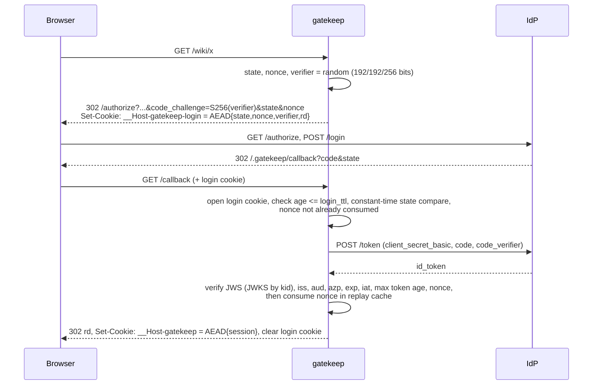
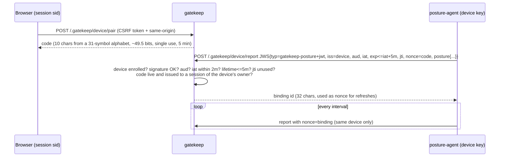

# gatekeep architecture

This document covers the request pipeline, the protocols gatekeep implements, the key algorithms and their complexity, and how state is held. For security reasoning, see [THREAT_MODEL.md](THREAT_MODEL.md).

## 1. Components and trust boundaries

```mermaid
flowchart TB
  subgraph Untrusted
    Browser
    Agent[posture-agent]
    Net[Network / other hosts]
  end
  subgraph gatekeep process
    GW[gateway.Gateway<br/>ServeHTTP]
    RP[oidc.Client<br/>+ RemoteKeySet]
    KR[session.KeyRing]
    PS[posture.Store + Verifier]
    PE[policy.Engine<br/>compiled CEL]
    AL[audit.Logger]
  end
  IdP[(OIDC provider)]
  Up[Upstream apps]
  Browser -->|HTTPS| GW
  Agent -->|HTTPS signed JWS| GW
  GW --> RP --> IdP
  GW --> KR
  GW --> PS
  GW --> PE
  GW --> AL
  GW -->|HTTP(S) + X-Gatekeep-Assertion| Up
```

gatekeep trusts:
- the **IdP**, reached over HTTPS with a pinned issuer, for identity claims;
- its own **secrets**: cookie master secrets, the upstream signing key, and enrolled device public keys;
- its **configuration**.

It trusts nothing that arrives from the browser, the agent or the network unless gatekeep sealed or signed it itself, or it carries a valid signature from the IdP or from an enrolled device key.

## 2. Request pipeline

`Gateway.ServeHTTP` assigns a request ID and handles internal paths (`/.gatekeep/*`) itself; every other path goes through `serveProxied`:

| Step | Check | Failure (audit reason) |
|---|---|---|
| 1 | Path is canonical: no `.`/`..`/empty segments, no backslash | 400 `non_canonical_path` |
| 2 | Route match (exact host before wildcard, then longest segment-aligned prefix) | 404 `no_route` |
| 3 | Session cookie: decrypt (AAD = session purpose), absolute and idle timeouts, issuer, revocation set | `session_invalid` / `session_expired` / `session_idle` / `session_revoked` (cookie cleared) |
| 4 | No session on a protected route: browser navigation gets a 302 to the IdP; API calls get a 401 JSON | `login_redirect` / `unauthenticated` |
| 5 | Build `policy.Input`: identity from the session, device from the posture store (`fresh`/`stale`/`absent`), request attributes | — |
| 6 | Unsafe method gets an origin check (`Sec-Fetch-Site`, then `Origin`, then `Referer`) | 403 `csrf_origin` |
| 7 | `require_device` needs fresh posture | 403 `device_required` / `posture_stale` |
| 8 | CEL policy (deny-overrides) | 403 `denied_by_rule` / `deny_rule_error` / `no_matching_allow` / `policy_cost_exceeded` |
| 9 | Re-issue the cookie if `LastSeen` is older than the touch interval (sliding idle timeout) | — |
| 10 | Reverse proxy: strip `X-Gatekeep-*` (any case, `_` or `-`) and gatekeep cookies, add identity headers plus a signed ES256 assertion; on the response, add missing security headers, remove `Server`/`X-Powered-By`, drop upstream `Set-Cookie` that would shadow gatekeep cookies | 502 `upstream_error` |
| 11 | A deferred audit record with status and latency, appended to the chain | — |

## 3. Login (authorization code + PKCE)



ID-token validation follows OIDC Core §3.1.3.7:

- the `alg` must be in `{RS256, ES256}` and must match the key type;
- `iss` must equal the discovered issuer, which must itself equal the configured issuer;
- `aud` must contain `client_id`; with more than one audience `azp` is required, and when present `azp` must equal `client_id`;
- `exp`, `nbf` and `iat` are checked with leeway, and `iat` is required;
- `now - iat <= max_token_age`;
- `nonce` must equal the sealed nonce (constant-time compare);
- `sub` must be non-empty;
- `auth_time` is checked against `max_auth_age` when that is configured.

### JWKS cache (`oidc.RemoteKeySet`)

- On a cache hit (kid known and TTL valid) the key is returned with no I/O: O(k) over the k keys in the set (k is about 2).
- An unknown kid triggers a refresh, so new keys are picked up immediately after IdP rotation.
- Refreshes are **rate-limited** to one per `MinRefreshInterval` (default 10 s), so tokens with random `kid`s cannot be used to hammer the IdP.
- Concurrent misses share **one in-flight fetch** (a channel acts as the single-flight latch).
- The TTL comes from `Cache-Control: max-age`, clamped to [1 min, 24 h], with a 1 h default.
- If a refresh fails, the previous key set stays usable (**stale-if-error**), but a kid that is not in it still fails.

## 4. Cookies and sessions

- **Key derivation:** each master secret (32 bytes or more, taken from the environment) goes through HKDF-SHA256 with info `"gatekeep cookie aes-256-gcm v1"` to produce an AES-256-GCM key. The key id is the first byte of a SHA-256 over the secret, so the ring can be reordered safely. The first secret seals new cookies; the others are accepted for opening (rotation). A key-id collision is rejected at startup.
- **Wire format:** `base64url(version || keyID || nonce(12) || ciphertext||tag)`. The nonce is a fresh random value per seal. Outputs above 3,800 bytes are refused.
- **Purpose binding:** the AAD is `version || purpose`, with purposes `gatekeep/session/v1` and `gatekeep/login/v1`. A sealed login state therefore cannot be used as a session cookie, even though both use the same keys (tested in `TestNegativeTamperedCookie`).
- **Lifetimes:** absolute (default 8 h, fixed at login) and idle (default 1 h, slid by re-issuing the cookie at most once per minute).
- **Logout:** the cookie itself is stateless, so its `sid` goes into a revocation set until the session's own expiry. Posture for the session is dropped at the same time.

Seal and open cost O(n) in payload size (AES-GCM); the session payload is a few hundred bytes.

## 5. Device posture



- Accepted posture is stored as `Record{device, facts, verified_at}` keyed by session ID.
- At request time the record is **fresh** when `now - verified_at <= posture.max_age`. Otherwise it is **stale**: the policy sees `device.present == false` and the audit log records `device_state=stale`.
- Binding expiry (equal to the session's absolute lifetime) and logout remove both the binding and the record.
- Pairing codes are drawn by rejection sampling, so there is no modulo bias.

Store operations are O(1) map lookups. Garbage collection on insert is O(p + b) over the live pairings and bindings, which are small and bounded by active sessions.

## 6. Policy engine

- **Environment:** `ext.NativeTypes` exposes three Go structs (`policy.Identity`, `policy.Device`, `policy.Request`) with field names taken from `cel:"..."` tags. Expressions are **type-checked at load**, and a non-bool expression is rejected. On top of the standard library the environment adds the `strings` and `sets` extensions and a custom `ip.in_cidr(cidr)`; parsed prefixes are cached in a `sync.Map`.
- **Programs** are planned once with `OptOptimize`, a per-rule **cost limit** (default 10,000) and interrupt checks, and evaluated with `ContextEval`.
- **Semantics:**
  1. If any deny rule evaluates true, or **errors**, the request is denied (fail closed).
  2. Otherwise, the first allow rule that evaluates true allows the request.
  3. Otherwise the request is denied (`no_matching_allow`).
  - An allow rule that errors is recorded and treated as false.
- **Complexity:** evaluation is O(sum of rule costs) and is capped at `rules × cost_limit`. Typical rules cost a few to a few dozen units. `BenchmarkPolicyEvaluate` measures about 5 µs for a 3-rule route.

## 7. Audit log

Each record is a JSON object with `seq`, `prev` and `hash`, where `hash = SHA-256(JSON(record with hash=""))` and `prev` is the previous record's hash (genesis is 64 zeros). Field order is fixed by the Go struct, so the JSON encoding is deterministic.

- **What is detected:** `Verify` recomputes every hash and link and checks that `seq` is contiguous, in O(n) time and O(1) memory (streaming). That catches modification, deletion, insertion and reordering of records.
- **What is not detected:** truncation of the tail. That needs the head hash anchored somewhere external; `Verify` and `audit-verify` print it for this purpose.
- **Restart:** `audit.OpenFile` verifies the existing file before appending and refuses to extend a broken chain.
- **Write order:** records are written under a mutex, so the chain order matches the write order. A failed write does not advance the chain.

## 8. Upstream identity assertion

Each forwarded request carries `X-Gatekeep-Assertion`, a JWS with `typ=gatekeep-identity+jwt` signed with ES256. Its claims are:

- `iss`: the gatekeep origin
- `aud`: `gatekeep:route:<name>`
- `sub`, `email`, `groups`
- `device_id`, `device_state`, `request_id`
- `exp`: 60 s after issue

The verification key is published at `/.gatekeep/jwks.json`. The demo `whoami` upstream verifies the assertion and rejects requests without a valid one. This is the defence if the upstream is reached by a path that bypasses gatekeep's header stripping.

## 9. State summary

| State | Where | Lifetime | Multi-instance? |
|---|---|---|---|
| Session | Encrypted cookie | absolute/idle timeouts | yes (stateless) |
| Login state (PKCE verifier, nonce, state) | Encrypted cookie | `login_ttl` | yes |
| Consumed nonces | `replay.Cache` (heap + map, O(log n) insert) | token exp + login_ttl | **no** (in-memory) |
| Revoked session IDs | `replay.Cache` | until session expiry | **no** |
| Posture pairings/bindings/records | `posture.Store` | 5 min / session lifetime | **no** |
| Posture `jti`s | `replay.Cache` | assertion exp + leeway | **no** |
| JWKS | `RemoteKeySet` | max-age, clamped | per instance (fine) |

The replay caches have a hard capacity. When full they **fail closed** with `ErrFull` instead of evicting live entries, since eviction would reopen a replay window.

## 10. Package dependency graph

```text
cmd/gatekeep -> config, server, audit, policy, jose, devcert
server       -> config, gateway, oidc, policy, posture, session, audit, replay, jose
gateway      -> oidc, session, posture, policy, audit, replay, jose
oidc         -> jose
posture      -> jose, replay
idp          -> oidc, jose
policy       -> cel-go, yaml
```

`jose`, `replay`, `session` and `audit` depend only on the standard library.
